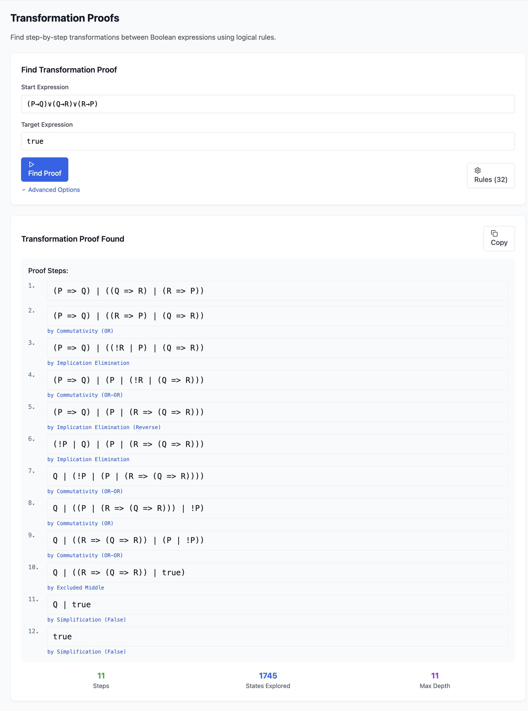
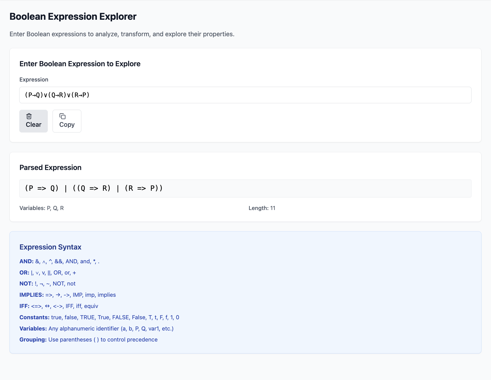
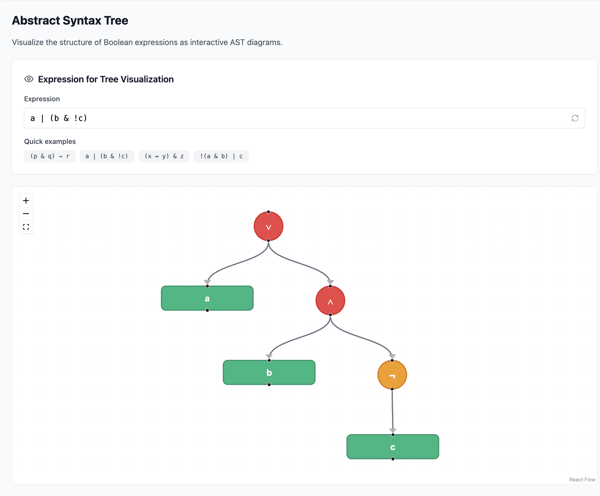
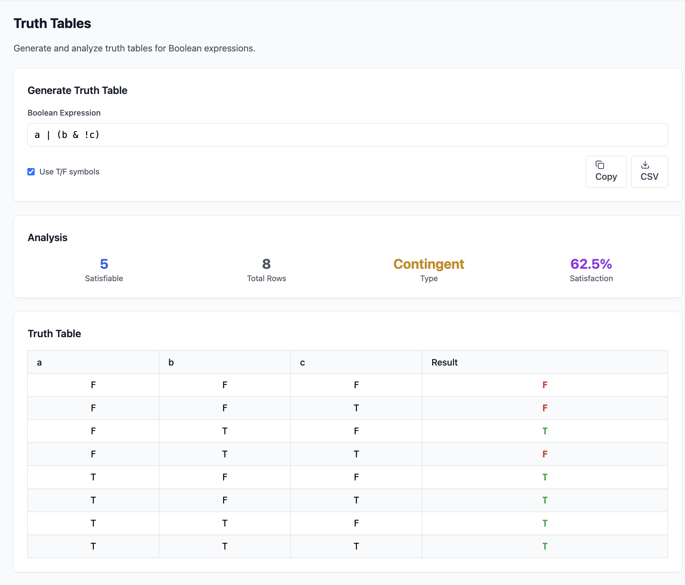

# Boolean Logic Proof Generator

This tool finds step-by-step transformations between two Boolean expressions using formal logic rules. It’s useful for analyzing propositional logic and can help verify logical equivalences without doing all the algebra by hand.

## Proof Generator

Given two Boolean expressions, the proof generator searches for a sequence of valid transformations that convert the start expression into the target.
Example:

* Start: `(A ∧ B) ∨ (A ∧ ¬B)`
* Target: `A`

Generated steps:

1. `(A ∧ B) ∨ (A ∧ ¬B)` → `A ∧ (B ∨ ¬B)`   *(Distributivity)*
2. `A ∧ (B ∨ ¬B)` → `A ∧ T`   *(Excluded Middle)*
3. `A ∧ T` → `A`   *(Simplification)*

---

## Expression Parser

Parses Boolean expressions and shows the recognized structure, operators, and variables.
Supports both Unicode operators (`∧`, `∨`, `¬`) and text notation (`AND`, `OR`, `NOT`).

---

## Abstract Syntax Tree

Displays the parsed structure of an expression as an interactive tree.
Nodes represent operators and variables, and edges show evaluation order.

---

## Truth Tables

Generates a complete truth table for any Boolean expression.
The table shows results for all combinations of variable values and indicates whether the expression is a tautology, contradiction, or contingent.

---

## Troubleshooting

If you encounter issues, try the following:

* Adjust **Advanced Options**, especially **Max Expression Length**.
* Variables are case sensitive — `A` and `a` are treated as different symbols.
* Proofs that require adding entirely new values or variables are not supported. In some cases, reversing the order of the start and target expressions may allow a proof to be found.
